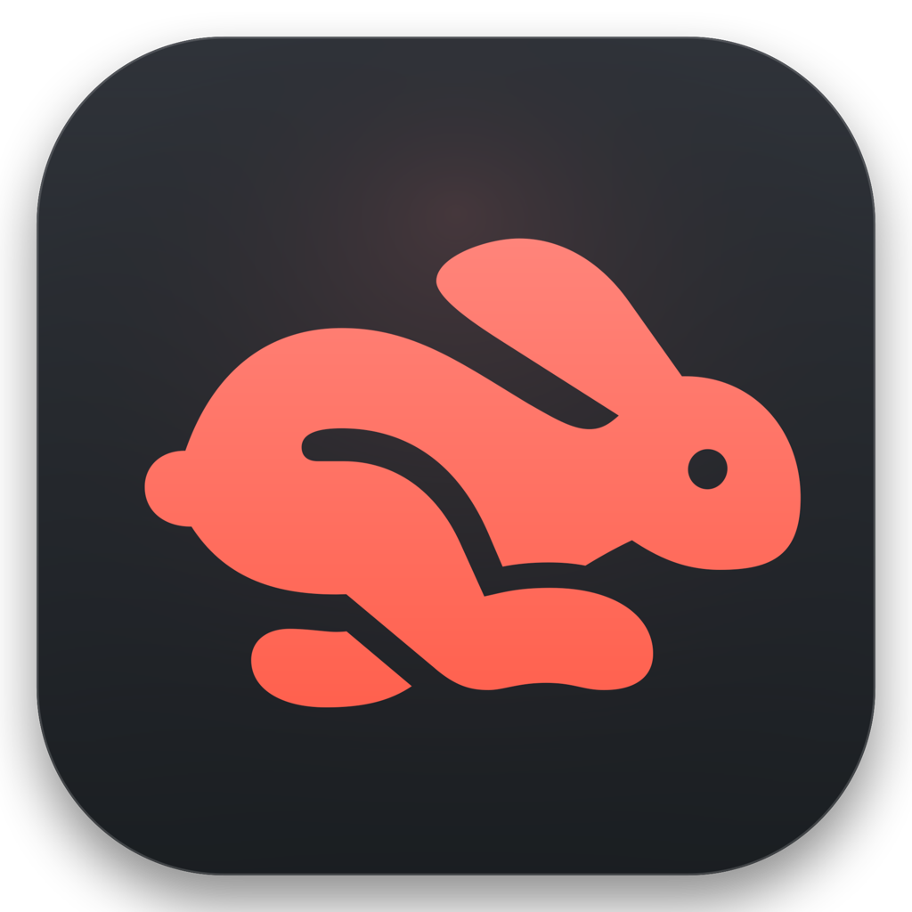

<div align="center">



# Animatto

**Living desktop companions, a desktop aquarium and ambient worlds for your Mac.**

[](https://github.com/sharmao07/Animatto/actions/workflows/macos-build.yml)
[](https://github.com/sharmao07/Animatto/releases)
[](https://www.apple.com/macos/)
[](https://swift.org/)
[](LICENSE)

[Download](https://github.com/sharmao07/Animatto/releases/latest) · [Features](#features) · [Install](#install) · [Build](#build-from-source) · [Website](#website) · [Contribute](#contributing)

</div>

---

## What is Animatto?

Animatto is a native macOS app (Swift, SwiftUI, AppKit) that turns your desktop into a small living world. Companions walk, jump, fall and sleep on your real desktop, stand on your open windows, react to the weather and to each other, and keep you company while you work.

It runs on **macOS 14.6 or later**, on **Apple Silicon and Intel**, and the core is **open source under Apache-2.0**.

## Features

| | |
|---|---|
| **Desktop physics** | Autonomous roaming, gravity, walking, running, jumping, falling, window-top walking, upside-down menu bar walking, drag and fling, multiple companions. |
| **Personality** | Ten archetypes with needs (energy, happiness, curiosity, boredom), contextual speech bubbles, quiet mode and anti-spam logic. |
| **Memory and social** | Local-only memory of interactions; companions greet and play with each other. |
| **Aquarium** | A transparent desktop aquarium with four original species (Finny, Pip, Glow, Barnaby), schooling, feeding, glass taps, bubbles, plants and ambient sound. |
| **Ambient Worlds** | Rain, snow, fog, sunlight, wind dust and autumn leaves; six built-in presets, custom presets, `.animattopack` import/export, Open-Meteo weather sync, Inverse Weather Mode and a collectibles minigame. |
| **Creator Studio** | On-device Magic Eraser (Apple Vision, including animated GIFs), cloud AI sprite generation, a community companion browser with attribution sidecars, and imports of your own sprites. |
| **Productivity** | Focus timers (5, 15, 30, 60 min) and Pomodoro (25/5, 50/10) that companions react to, resilient to sleep and wake. |
| **Menu bar** | Pause, mute, switch companions, feed the aquarium and use the Privacy Shield without opening the main window. |
| **Integrations** | Discord Rich Presence, Spotify and Apple Music status, GitHub Releases update checks. |
| **Accessibility** | Reduced Motion support and 11 languages: English, Spanish, French, German, Italian, Japanese, Korean, Simplified and Traditional Chinese, Brazilian Portuguese, Russian. |

## Install

1. Download the latest `.dmg` from [GitHub Releases](https://github.com/sharmao07/Animatto/releases/latest).
2. Open it and drag **Animatto.app** into **Applications**.
3. Open Animatto. If macOS warns about an unidentified developer, Control-click the app, choose **Open**, then confirm. You only need to do this once.

Some releases may be ad-hoc signed and not notarized. Never disable Gatekeeper globally. See `How to install.txt` in the DMG for a visual guide.

| Requirement | |
|---|---|
| OS | macOS 14.6 (Sonoma) or newer |
| Chip | Apple Silicon or Intel |
| Permissions | None required. Optional: Automation for Spotify and Apple Music, Screen Recording for Screen Awareness. |

## Build from source

```bash
git clone https://github.com/sharmao07/Animatto.git
cd Animatto
open Animatto.xcodeproj          # or build from the command line:
xcodebuild -project Animatto.xcodeproj -scheme Animatto -configuration Debug build
```

## Use your own characters

Animatto bundles only its original artwork. You can import sprite packs, GIFs and transparent PNGs you own:

1. Open Animatto from the menu bar and go to **Companion Library**, then **Import Character** (or drag a folder in).
2. If a sprite has a solid background, drop it into **Magic Eraser** in the Workshop to remove it on-device.

Always check a pack's license and respect its creator. See [docs/ASSET_LICENSE_AUDIT.md](docs/ASSET_LICENSE_AUDIT.md).

## Free and Premium

The core app is free forever under Apache-2.0: companions, personalities, memory, the aquarium, Ambient Worlds, imports, timers and privacy features. **Animatto Premium is planned and is not on sale yet.** Details and the free-core guarantees are in [docs/FREE_PREMIUM_BOUNDARIES.md](docs/FREE_PREMIUM_BOUNDARIES.md).

## Website

The site in [`web/`](web/) has 13 static pages and in-browser demos of the aquarium, ambient scenes, personalities and focus timer. The demos are previews, not the macOS app.

```bash
cd web
npm run build   # regenerate pages, sitemap and robots.txt
npm test        # validate pages, links, metadata and JS
```

See [web/README.md](web/README.md) for configuration and deployment.

## Privacy and security

- **On-device AI:** Magic Eraser runs on your Mac with Apple Vision. Images are not uploaded.
- **Local data:** companion memory and preferences stay on your Mac.
- **No telemetry:** no analytics SDKs, ad trackers or background telemetry.
- **Optional network use:** Open-Meteo weather sync, cloud AI sprite generation, community companion search and GitHub update checks use the network only when enabled or triggered. Discord talks to its local socket.

Report vulnerabilities as described in [SECURITY.md](SECURITY.md).

## Project layout

```
Animatto/           Swift sources: engine, personality, aquarium, ambient, audio, UI
Tests/              Test harness
cross-platform/     Portable TypeScript engine and Tauri prototype
web/                Website, demos and serverless payment code
docs/               Architecture, licensing and product docs
scripts/            Build, packaging and asset-generation scripts
```

## Contributing

Contributions are welcome. Read the [Contributing Guide](CONTRIBUTING.md) and the [Code of Conduct](CODE_OF_CONDUCT.md), then:

1. Fork the repo and create a branch: `git checkout -b feature/my-change`
2. Commit: `git commit -m "feat: my change"`
3. Push and open a [pull request](https://github.com/sharmao07/Animatto/pulls).

## Contributors

Animatto is built by its maintainer together with AI coding partners.

<table>
  <tr>
    <td align="center"><a href="https://github.com/sharmao07"><br><sub><b>Sharma</b></sub></a><br><sub>Maintainer</sub></td>
    <td align="center"><a href="https://github.com/claude"><b>Claude</b></a><br><sub>Website and docs</sub></td>
    <td align="center"><a href="https://github.com/google-antigravity"><br><sub><b>Google Antigravity</b></sub></a><br><sub>AI coding agent</sub></td>
    <td align="center"><a href="https://github.com/codex"><br><sub><b>OpenAI Codex</b></sub></a><br><sub>AI coding assistant</sub></td>
    <td align="center"><a href="https://github.com/google-gemini"><br><sub><b>Google Gemini</b></sub></a><br><sub>Research and QA</sub></td>
  </tr>
</table>

## License

Apache License 2.0. See [LICENSE](LICENSE). Mac and macOS are trademarks of Apple Inc.; Animatto is not affiliated with Apple.
