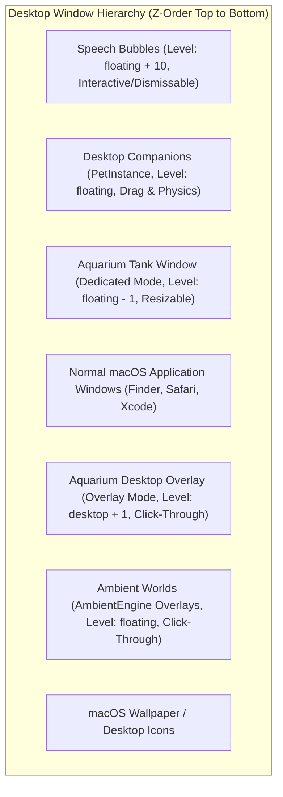
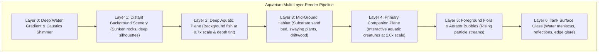
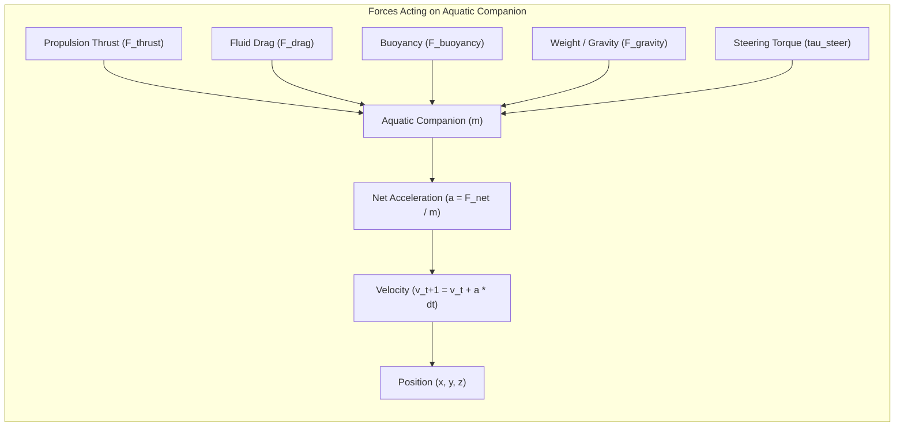
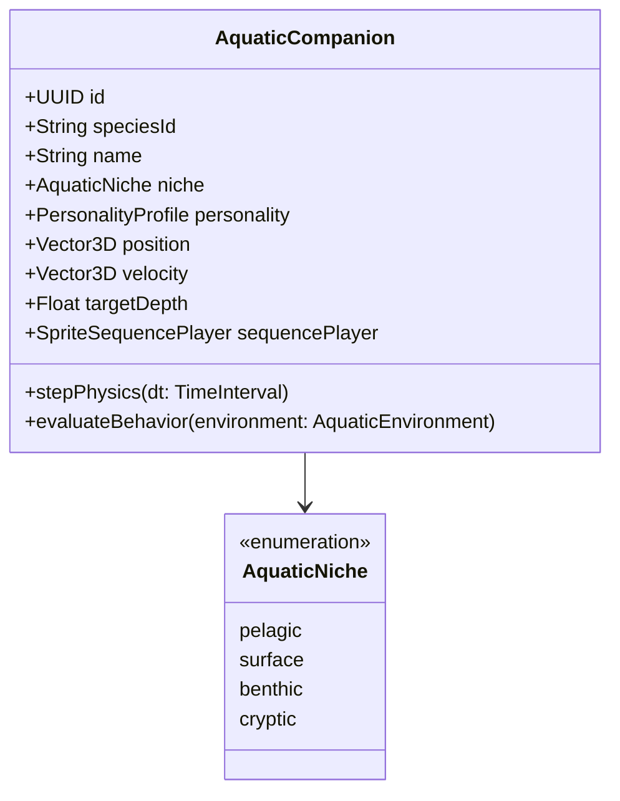
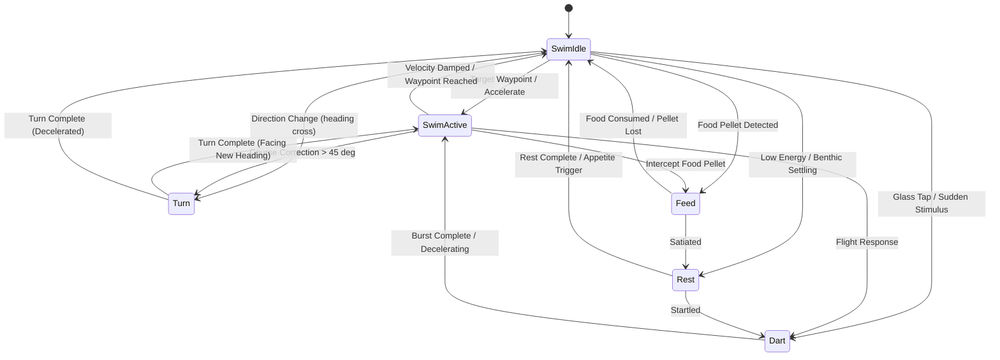
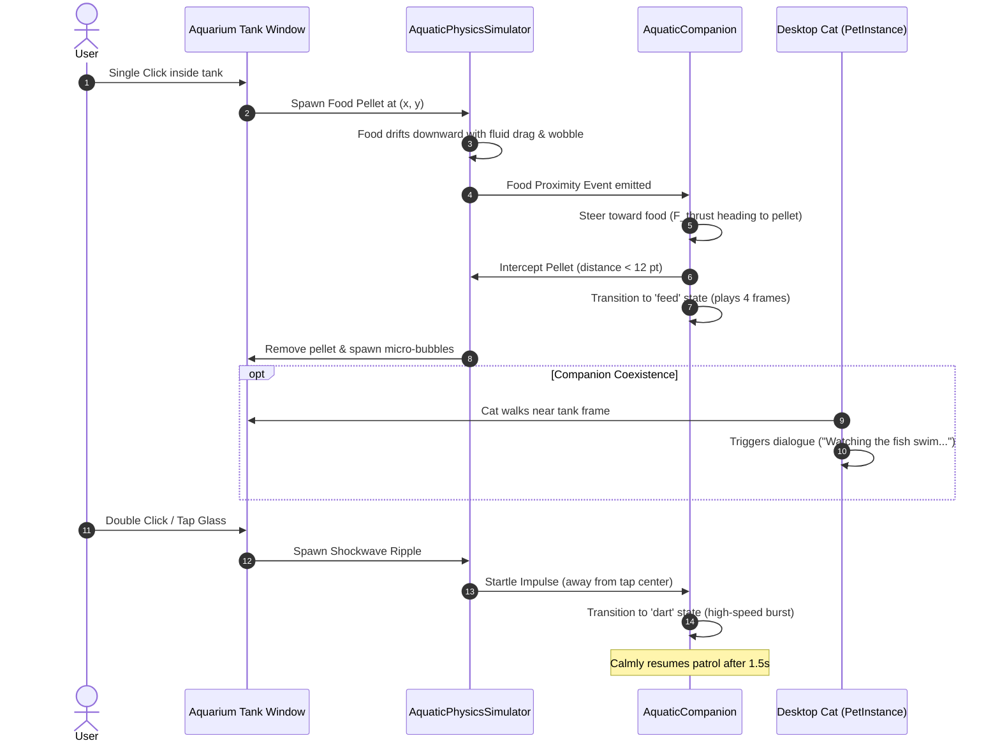
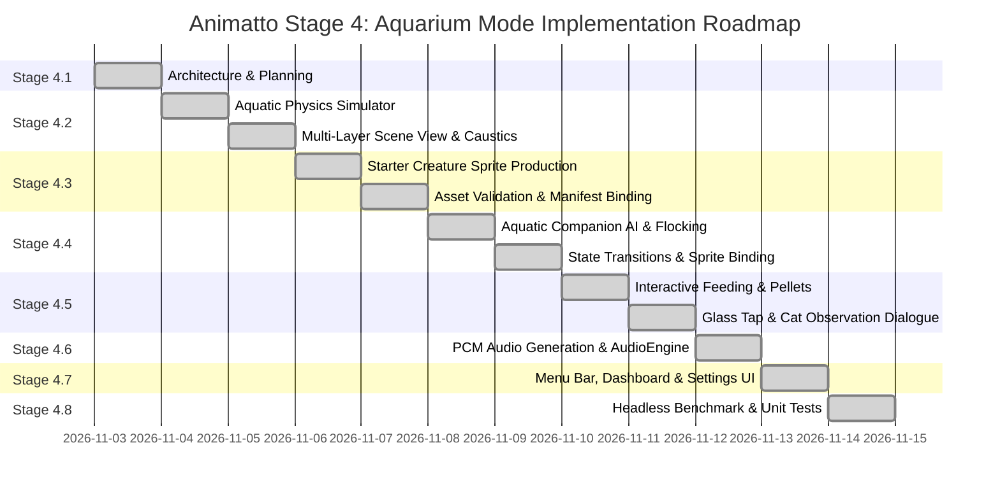

# Animatto — Stage 4: Aquarium Mode Architecture & Technical Specification

**Stage:** 4 (Aquarium Mode Architecture & Complete Implementation — Stages 4.1–4.8)  
**Status:** Complete & Verified  
**Author:** `sharmao07`  
**Target Platforms:** macOS 14.6+ (Sonoma) and macOS 15+ (Sequoia) on Apple Silicon & Intel  
**Coexistence Matrix:** Desktop Companions (`PetEngine`), Ambient Worlds (`AmbientEngine`), and Window Platform Tracker (`WindowPlatformTracker`)

---

## 1. Executive Summary & Existing System Audit

Animatto currently delivers desktop companionship through two distinct rendering and simulation pipelines:
1. **Desktop Gravity Companions ([PetEngine.swift](file:///Users/ojussharma/Desktop/KinetiPet/Animatto/PetEngine.swift)):** Individual companions operate inside dedicated borderless, transparent floating `NSPanel` windows (`window.level = .floating`). Companions simulate Newtonian terrestrial physics ($g = 9.8\text{ m/s}^2$) via [CompanionPhysicsSimulator](file:///Users/ojussharma/Desktop/KinetiPet/Animatto/PetEngine.swift), traversing desktop window ledges detected by [WindowPlatformTracker.swift](file:///Users/ojussharma/Desktop/KinetiPet/Animatto/WindowPlatformTracker.swift) or walking along the display baseline.
2. **Ambient Worlds ([AmbientEngine.swift](file:///Users/ojussharma/Desktop/KinetiPet/Animatto/AmbientEngine.swift)):** Full-screen transparent, click-through `NSPanel` overlays (`ignoresMouseEvents = true`, `level = .floating`) render weather and atmosphere particle effects (rain, snow, autumn leaves, starlight) across active displays using Quartz `NSView` drawing.
3. **Sprite Animation Infrastructure ([AnimationAssetCache.swift](file:///Users/ojussharma/Desktop/KinetiPet/Animatto/AnimationAssetCache.swift) & [SpriteSequencePlayer.swift](file:///Users/ojussharma/Desktop/KinetiPet/Animatto/SpriteSequencePlayer.swift)):** Pre-decoded 256×256 `CGImage` buffers are loaded asynchronously, stored in a thread-safe singleton cache with state-level pinning, bounded memory budgets (~12–15 MB), and LRU eviction, advancing frames monotonically based on [manifest.json](file:///Users/ojussharma/Desktop/KinetiPet/Animatto/AnimationManifest.swift).

### The Vision for Aquarium Mode
Aquarium Mode introduces a peaceful, living aquatic desktop environment that users can enjoy either as:
- A **Dedicated Glass Tank Window**: A movable, resizable, interactive aquatic sanctuary placed anywhere on the desktop.
- A **Full-Desktop Water World Overlay**: A subtle, ambient underwater backdrop resting between the desktop wallpaper and application windows.

Crucially, **Aquarium Mode does not replace or disrupt existing desktop companions or ambient worlds.** An active cat companion can continue walking across the screen, even pausing near the aquarium glass to curiously gaze at swimming creatures, while ambient rain or snowfall gently drifts in the background.



### Coexistence Principles
- **No Shared State Mutation:** Aquarium physics, water current, and creature entities execute inside an independent `AquariumManager` and `AquaticPhysicsSimulator`, completely decoupled from `CompanionPhysicsSimulator`.
- **Zero Event Interference:** In Desktop Overlay Mode, all mouse events pass straight through (`ignoresMouseEvents = true`), preserving 100% usability of background applications. In Tank Window Mode, mouse interaction is bounded strictly within the tank's frame.
- **Shared Decoded Frame Cache:** Aquatic creatures reuse `AnimationAssetCache.shared`, sharing pre-decoded `CGImage` frame pools so that schooling identical fish incur zero duplicate image memory.
- **Unified Audio Ducking:** Aquatic audio (filter aerator hum, gentle water bubbling) runs through `AudioEngine` with independent volume controls and automatic ducking when companions speak or focus timers trigger.

---

## 2. Aquarium Scene Architecture & Multi-Layer Rendering

The aquarium scene is composed of **seven distinct visual depth layers** rendered in back-to-front order. This layered architecture creates convincing optical depth, aquatic refraction, and atmospheric water perspective while maintaining battery-efficient rendering.



### Layer Specifications

| Layer | Component | Rendering Technique | Visual Purpose |
|---|---|---|---|
| **0. Water Backing** | `WaterAtmosphereLayer` | Procedural CoreGraphics vertical linear gradient with dual-sine caustic shimmer | Establishes aquatic mood (freshwater emerald, tropical reef cyan, or midnight abyss navy) |
| **1. Far Background** | `DistantSceneryLayer` | Low-contrast vector/bitmap silhouettes with 2.0 pt Gaussian blur | Adds scenic backdrop (distant rock arches, deep kelp forest) with depth-of-field |
| **2. Deep Plane** | `BackgroundCreaturesLayer` | Sub-scale companion rendering ($0.65\times$–$0.75\times$ scale) with 20% water color tinting | Simulates schooling fish swimming deep in the tank without interactive collision |
| **3. Mid Habitat** | `SubstrateAndFloraLayer` | Sand bed contour with rounded pebbles; procedural spline-animated aquatic plants | Forms resting perches and natural boundaries; plants sway using harmonic frequency $\omega = 0.8\text{ rad/s}$ |
| **4. Active Plane** | `PrimaryAquaticPlaneView` | Full-detail 256×256 sprite sequences via `SpriteSequencePlayerView` | Hosts primary user-selected aquatic companions, interactive food targeting, and obstacle avoidance |
| **5. Foreground** | `BubbleStreamLayer` | Quartz 2D instanced particle system with sinusoidal horizontal wobble | Aerator bubbling columns and water aeration effects rising toward the surface |
| **6. Glass & Rim** | `AquariumGlassOverlayView` | CoreAnimation gradient rim, subtle top water meniscus line, specular glints | Provides realistic physical framing in Tank Window Mode; disabled in Desktop Overlay Mode |

### Dual Presentation Modes

#### A. Dedicated Tank Window Mode
- Implemented as an `NSPanel` with style masks `[.borderless, .resizable, .nonactivatingPanel]`.
- Configurable window dimensions: Compact ($480 \times 320$), Standard ($720 \times 480$), Panoramic ($960 \times 540$), or freeform custom resizing.
- Includes a minimalist top glass header with pin-to-top, sound toggle, feeding shortcut, and close button that fades in on hover.
- Glass boundaries reflect aquatic creatures, preventing them from swimming outside the tank envelope.

#### B. Full-Desktop Water World Overlay Mode
- Implemented via screen-sized `NSPanel` instances matching active `NSScreen.screens` geometry.
- Operates at window level `NSWindow.Level(Int(CGWindowLevelForKey(.desktopWindow)) + 1)` (resting immediately above desktop wallpaper, beneath application windows).
- Sets `ignoresMouseEvents = true`, guaranteeing desktop application clicks and drag selections are completely unaffected.
- Substrate sits along the dock/menu bar floor, and bubbles gently rise along the screen borders.

---

## 3. Aquatic Movement & Fluid Physics Engine

Unlike terrestrial companions governed by gravity, ledge falling, and ground contact, aquatic creatures exist in a continuous 3D-in-2D fluid medium governed by buoyancy, hydrodynamic drag, propulsion thrust, and steering torque.



### Mathematical Formulation of Fluid Motion

1. **Hydrodynamic Drag Force ($\vec{F}_{\text{drag}}$):**
   Fluid resistance opposes the creature's motion proportionally to the square of velocity:
   $$\vec{F}_{\text{drag}} = -\frac{1}{2} \, \rho \, C_d \, A \, |\vec{v}| \, \vec{v}$$
   Where:
   - $\rho$: Simulated water density ($1.0\text{ g/cm}^3$).
   - $C_d$: Streamlined drag coefficient ($0.04$ for streamlined fish, $0.12$ for pufferfish).
   - $A$: Cross-sectional frontal area derived from companion size.
   - $\vec{v}$: Current creature velocity vector $(v_x, v_y, v_z)$.

2. **Buoyancy & Vertical Equilibrium ($\vec{F}_{\text{net\_vert}}$):**
   Aquatic creatures possess variable swim bladder simulation:
   $$\vec{F}_{\text{net\_vert}} = (\rho_{\text{fluid}} \cdot V - m) \cdot g + F_{\text{swim\_pitch}}$$
   - **Neutral Buoyancy:** For pelagic fish, body density equals fluid density ($\rho_{\text{body}} \approx \rho_{\text{fluid}}$), requiring zero energy to maintain depth.
   - **Negative Buoyancy:** Benthic bottom dwellers (e.g. hermit crabs, catfish) have $\rho_{\text{body}} > \rho_{\text{fluid}}$, naturally settling onto the substrate when stationary.
   - **Positive Buoyancy:** Surface-feeding species have slight upward drift when resting near the meniscus.

3. **3D Depth Simulation in a 2D Canvas ($Z \in [0.0, 1.0]$):**
   Companions navigate a continuous virtual 3D bounding box $[0, W] \times [0, H] \times [0.0, 1.0]$:
   - $Z = 0.0$: Foreground plane (closest to glass, full scale $1.0\times$, full saturation).
   - $Z = 1.0$: Deep background plane (furthest back, scale $0.65\times$, 30% blue-green haze).
   - **Visual Scale Projection:**
     $$s(Z) = s_0 \cdot (1.0 - 0.35 \cdot Z)$$
   - **Water Haze Absorption:**
     $$\text{Color}_{\text{projected}} = (1.0 - 0.28 \cdot Z) \cdot \text{Color}_{\text{base}} + (0.28 \cdot Z) \cdot \text{Color}_{\text{water}}$$

4. **Steering, Turning & Banking Mechanics:**
   - Heading angle $\theta = \operatorname{atan2}(v_y, v_x)$ is smoothed using angular interpolation (spherical slerp / damped exponential smoothing) with max turn rate $\omega_{\max} = 180^\circ/\text{s}$.
   - When horizontal velocity direction changes ($v_x$ crosses $0$), the creature initiates a transitional `turn` sequence (3–4 frames) before flipping its horizontal sprite rendering scale (`scaleEffect(x: -1)`).
   - Roll/Bank angle $\phi = \operatorname{clamp}(-\frac{v_x \cdot \omega}{g}, -15^\circ, 15^\circ)$ tilts the body into the turn during sharp maneuvers.

5. **Boundary Repulsion & Soft Reflection:**
   To prevent unnatural wall collisions, an exponential soft-repulsion force acts within distance $d_{\text{margin}} = 48\text{ pt}$ from boundaries:
   $$\vec{F}_{\text{repel}} = k_{\text{boundary}} \cdot \left(\frac{d_{\text{margin}} - d}{d_{\text{margin}}}\right)^2 \cdot \hat{n}$$
   Where $\hat{n}$ is the inward normal of the boundary (glass walls, surface, or substrate).

---

## 4. Extensible Aquatic Companion Model & Starter Species

The aquatic companion model is built on an extensible protocol architecture (`AquaticCompanion`) sharing foundational personality traits with [PersonalityProfile.swift](file:///Users/ojussharma/Desktop/KinetiPet/Animatto/PersonalityModel.swift), while specializing for ecological niches.

### Ecological Niches



- **`Pelagic` (Open-Water Cruiser):** Swims continuously at mid-depth ($Z \in [0.2, 0.7]$, $Y \in [0.3H, 0.8H]$). Exhibits schooling tendencies and rhythmic fin beats.
- **`Surface` (Top Explorer):** Prefers upper 20% of the tank. Frequently inspects the water surface, checks for food flakes, and breaches the meniscus with tiny air-bubble rings.
- **`Benthic` (Bottom Dweller):** Wanders along the sand substrate ($Y \le 40\text{ pt}$). Scavenges fallen food, scuttles over pebbles, and rests near decor.
- **`Cryptic` (Cave & Flora Dweller):** Seeks shelter in aquatic plants and rock arches. Darts between hiding spots when startled.

---

### Starter Species Specifications (100% Original Artwork)

All characters are completely original, artistically styled to complement Animatto's visual master (`animatto_cat.png`), and free of copyrighted designs or external trademarked references.

```
+---------------------------------------------------------------------------------------------------+
| 1. "Finny" — Golden Sunfin (Heliochthys splendens)                                                |
| Niche: Pelagic Cruiser | Personality: Bold (0.8), Energetic (0.7), Friendly (0.8)                 |
| Visuals: Warm amber-gold teardrop body, flowing translucent gossamer fins with golden fringes,    |
|          large expressive dark eyes, delicate caudal tail flutter.                                |
| Signature Behavior: Performs gentle looping victory glides when fed; follows cursor curiosity.   |
+---------------------------------------------------------------------------------------------------+
| 2. "Pip" — Spotted Pygmy Puffer (Nanochanna guttatus)                                             |
| Niche: Curious Mid-Surface Explorer | Personality: Curious (0.9), Playful (0.6), Bold (0.4)      |
| Visuals: Rounded miniature pea-green body with soft olive spots, white belly, tiny fluttering     |
|          pectoral fins that buzz like hummingbird wings, expressive swiveling eyes.               |
| Signature Behavior: Hover-and-dart motion; gently puffs up 1.3x size when surprised, then deflates|
+---------------------------------------------------------------------------------------------------+
| 3. "Glow" — Neon Ghost Tetra (Spectrachthys caeruleus)                                            |
| Niche: Schooling Pelagic | Personality: Timid (0.3), Friendly (0.9), Playful (0.5)                  |
| Visuals: Semi-transparent crystalline silhouette revealing a gentle bioluminescent turquoise and |
|          magenta internal lateral line that softly pulses with ambient light.                     |
| Signature Behavior: Tight schooling coordination with other Glow instances; synchronized turns.   |
+---------------------------------------------------------------------------------------------------+
| 4. "Barnaby" — Mossy Hermit Crab (Paguropsis muscosus)                                            |
| Niche: Benthic Scavenger | Personality: Lazy (0.8), Curious (0.4), Bold (0.3)                     |
| Visuals: Rounded river-snail spiral shell carrying a miniature sprout of aquatic moss; warm       |
|          apricot legs that scuttle over sand; tiny curious periscope eye-stalks.                  |
| Signature Behavior: Scuttles along substrate; retreats inside shell if glass is tapped.           |
+---------------------------------------------------------------------------------------------------+
```

---

## 5. Animation Asset Architecture & Manifest Format

The aquatic animation pipeline reuses the battle-tested, high-performance architecture developed in Stage 3:
- **Frame Canvas Dimensions:** $256 \times 256$ pixels, RGBA 32-bit straight alpha transparency.
- **Color Profile:** sRGB IEC61966-2.1 standard gamut.
- **Orientation:** Canonical right-facing orientation. Leftward swimming is rendered dynamically via horizontal reflection matrix (`scaleEffect(x: -1)`), cutting asset footprint by 50%.
- **Zero-Copy Cache Reuse:** Every frame is loaded asynchronously and pre-decoded via `AnimationAssetCache.shared`. Ten identical schooling tetras consume memory for only a single set of frames in RAM.

### State Machine for Aquatic Companions



### State Specifications

| State Name | Type | Frame Count | Target FPS | Frame Duration | Loop Policy | Audio Trigger |
|---|---|:---:|:---:|:---:|---|---|
| **`swim_idle`** | Cyclic Loop | 6 frames | 10 fps | 100 ms | Continuous loop | Gentle fin flutter |
| **`swim_active`** | Cyclic Loop | 8 frames | 14 fps | 71 ms | Continuous loop | Subtle water displacement |
| **`turn`** | Transitional | 4 frames | 16 fps | 62 ms | Plays once, then switches to active/idle | None |
| **`feed`** | Transitional | 4 frames | 12 fps | 83 ms | Plays once at food collision point | Tiny water nip pop |
| **`rest`** | Cyclic Loop | 4 frames | 6 fps | 166 ms | Continuous while stationary | Contentment stillness |
| **`dart`** | High-Speed Burst | 4 frames | 20 fps | 50 ms | Plays once; triggers rapid velocity impulse | Soft swift whoosh |

### Extended Aquatic `manifest.json` Schema

The aquatic manifest extends the standard [AnimationManifest](file:///Users/ojussharma/Desktop/KinetiPet/Animatto/AnimationManifest.swift) schema while maintaining backward compatibility with `AnimationManifest.init(from: decoder)`:

```json
{
  "characterId": "animatto.creature.sunfin",
  "version": "1.0.0",
  "name": "Finny the Golden Sunfin",
  "species": "Heliochthys splendens",
  "masterArtwork": "sunfin_master.png",
  "canvasSize": {
    "width": 256,
    "height": 256
  },
  "groundBaselineY": 32,
  "aquaticProperties": {
    "niche": "pelagic",
    "depthPreference": {
      "minZ": 0.1,
      "maxZ": 0.8,
      "preferredZ": 0.4
    },
    "buoyancyType": "neutral",
    "cruiseSpeed": 65.0,
    "maxSpeed": 140.0,
    "turningSpeedDegPerSec": 180.0,
    "schoolingAffinity": 0.75
  },
  "states": {
    "swim_idle": {
      "folder": "swim_idle",
      "frameCount": 6,
      "frameDurationMs": 100,
      "loop": true
    },
    "swim_active": {
      "folder": "swim_active",
      "frameCount": 8,
      "frameDurationMs": 71,
      "loop": true
    },
    "turn": {
      "folder": "turn",
      "frameCount": 4,
      "frameDurationMs": 62,
      "loop": false,
      "nextState": "swim_active"
    },
    "feed": {
      "folder": "feed",
      "frameCount": 4,
      "frameDurationMs": 83,
      "loop": false,
      "nextState": "swim_idle"
    },
    "rest": {
      "folder": "rest",
      "frameCount": 4,
      "frameDurationMs": 166,
      "loop": true
    },
    "dart": {
      "folder": "dart",
      "frameCount": 4,
      "frameDurationMs": 50,
      "loop": false,
      "nextState": "swim_active"
    }
  }
}
```

---

## 6. Interaction Design & User Controls

Aquarium Mode emphasizes non-obstructive delight, providing peaceful ambient presence with gentle interactive moments.



### Interaction Mechanics

1. **Feeding System:**
   - Clicking inside the tank window drops 1–3 organic food pellets at the cursor location.
   - Pellets descend at terminal settling velocity $v_{\text{sink}} = 22\text{ pt/s}$ with gentle sinusoidal horizontal wobble ($f = 1.2\text{ Hz}$).
   - Creatures within sensory radius ($R_{\text{sense}} = 220\text{ pt}$) break from wandering and steer smoothly toward the closest pellet.
   - If a pellet reaches the substrate unconsumed, it dissolves into fine ambient micro-bubbles within 15 seconds, preventing tank clutter.
   - **Overfeed Protection:** A maximum of 8 active pellets can exist simultaneously; additional clicks produce a brief soft bubble ripple instead.

2. **Cursor Curiosity & Following:**
   - When the user's cursor hovers inside the tank, friendly species (e.g. Finny) gently swim toward the cursor, hovering curiously 30–50 pt away.
   - Rapid cursor movement causes timid species (e.g. Pip) to gently back away, demonstrating lifelike awareness.

3. **Glass Tap (Ripple & Scatter):**
   - Double-clicking or firmly tapping the glass produces an expanding circular refraction ripple.
   - Nearby creatures experience an immediate outward radial velocity impulse ($\vec{v}_{\text{scatter}}$), transitioning to the `dart` animation state before recovering to calm swimming within 1.5 seconds.

4. **Desktop Cat & Companion Interoperability:**
   - When a terrestrial cat companion approaches within 120 pt of the aquarium tank window:
     - The cat's `BehaviorEngine` enters an ambient observer mode, pausing autonomous roaming.
     - The cat faces the aquarium (`walkDirectionRight` orienting toward tank center) and enters `sit` or `idle` state.
     - Contextual dialogue is triggered: *"Mesmerized by the little golden fish..."*, *"Must resist tapping the glass..."*.
     - The cat's paws do not clip into the tank; coordinate bounds are strictly separated.

---

## 7. User Settings & Configuration Management

Aquarium settings integrate directly into Animatto's native macOS settings architecture, persisted under `UserDefaults` with key `"com.dev.Animatto.aquarium_settings"` and reactive SwiftUI state.

### Settings Data Model

```swift
public struct AquariumSettings: Codable, Equatable {
    // Mode & Presentation
    public var isEnabled: Bool = false
    public var presentationMode: AquariumPresentationMode = .dedicatedWindow
    public var tankSizePreset: TankSizePreset = .standard
    public var customWindowFrame: CGRect? = nil
    public var staysOnTop: Bool = false
    
    // Water Atmosphere & Aesthetics
    public var waterTheme: WaterAtmosphereTheme = .tropicalReef
    public var waterClarity: Double = 0.85          // 0.0 (murky riverbed) to 1.0 (crystal clear)
    public var causticIntensity: Double = 0.6       // Light refraction shimmer strength
    public var lightingCycleEnabled: Bool = true    // Day/dusk/night ambient color shift
    
    // Aeration & Particles
    public var bubbleIntensity: Double = 0.5        // Aerator flow rate
    public var plantDensity: Int = 4                // Number of swaying flora clusters
    public var qualityMode: AmbientQualityMode = .balanced
    
    // Audio
    public var soundEnabled: Bool = true
    public var aeratorVolume: Double = 0.35         // Gentle hum / bubbles
    public var waterSoundVolume: Double = 0.25      // Surface lapping
    
    // Population
    public var activeSpeciesIds: [String] = [
        "animatto.creature.sunfin",
        "animatto.creature.puffer",
        "animatto.creature.tetra"
    ]
    public var maxCreatureCount: Int = 6
    
    // Accessibility
    public var reduceMotion: Bool = false           // Calms fast swimming & disables caustics
}
```

### Visual Themes & Ambience Presets

| Theme | Raw Value | Water Gradient Colors | Ambient Tint | Lighting Character |
|---|---|---|---|---|
| **Tropical Reef** | `tropicalReef` | `#003B5C` $\rightarrow$ `#0099B8` $\rightarrow$ `#66E0D0` | Cyan / Turquoise | High caustic shimmer, bright midday sun |
| **Freshwater River** | `freshwaterRiver` | `#0A2E1A` $\rightarrow$ `#1F5E39` $\rightarrow$ `#52A468` | Emerald / Moss | Soft diffuse lighting, rich plant foliage |
| **Midnight Abyss** | `midnightAbyss` | `#020714` $\rightarrow$ `#081636` $\rightarrow$ `#1C2A58` | Indigo / Deep Blue | Bioluminescent glow, faint lunar caustics |
| **Sunset Lagoon** | `sunsetLagoon` | `#2D0B3A` $\rightarrow$ `#75254A` $\rightarrow$ `#E6735A` | Amber / Magenta | Warm golden hour highlights, soft shadows |

---

## 8. Performance Budgets, Accessibility & Resource Governance

Aquarium Mode is designed as an ambient background companion system, requiring strict bounds on battery, CPU, GPU, and RAM consumption.

### Performance Budgets

| Metric | Target (M1 / M2 / M3) | Maximum Upper Bound | Enforcement Mechanism |
|---|---|---|---|
| **CPU Utilization (Resting)** | $< 1.5\%$ single-core | $2.5\%$ | 30 Hz simulation timer; dirty-region drawing |
| **CPU Utilization (Feeding)** | $< 2.8\%$ single-core | $4.0\%$ | Short-lived 5-second feeding burst; returns to resting |
| **Display Frame Cadence** | 30–60 FPS adaptive | 60 FPS | Automatically throttles to 30 FPS on battery; 20 FPS on Low Power Mode |
| **Decoded Frame Memory** | $\le 16.0\text{ MB}$ (4 species) | $24.0\text{ MB}$ | Shared singleton `AnimationAssetCache`; zero duplicated bitmaps |
| **Total System RAM Footprint** | $\le 35.0\text{ MB}$ | $48.0\text{ MB}$ | Bounded particle counts; shared layer caching |
| **Mach Task Energy Units** | $< 150\text{ units/s}$ | $280\text{ units/s}$ | Suspension on display sleep / window occlusion |

### Battery & Power Governance
1. **Window Occlusion Detection:**
   When the Aquarium Tank window is completely obscured by other application windows (monitored via `NSWindow.occlusionState`), the rendering loop completely suspends, reducing CPU to $0.0\%$.
2. **Display Sleep & Screen Saver:**
   Subscribes to `NSWorkspace.screensDidSleepNotification` and `screensDidWakeNotification` via Combine, invalidating physics and particle timers during display sleep.
3. **Battery Telemetry Integration:**
   Monitors macOS battery power state via `IOKit.ps`. When battery level drops below 20% or macOS Low Power Mode is active, particle density drops by 60% and simulation tick rate drops to 20 Hz.

### Accessibility & Reduced Motion
- **Full `prefersReducedMotion` Compliance:**
  Subscribes to `NSWorkspace.shared.accessibilityDisplayShouldReduceMotion`. When enabled:
  - Complex multi-frequency caustic light refraction is disabled in favor of a static gradient.
  - Swift darting and sharp turns are smoothed to gentle, linear glides.
  - Bubble particle wobble is simplified to straight vertical ascent.
- **VoiceOver & Accessibility Elements:**
  The tank window provides meaningful accessibility descriptions: *"Animatto Aquarium: 3 fish swimming calmly. Press Space to drop food."*

---

## 9. Implementation Roadmap & Staging Plan



### Milestone Deliverables

1. **Stage 4.1 — Architecture & Technical Planning (Completed):**
   - Comprehensive technical design in `docs/AQUARIUM_MODE_ARCHITECTURE.md`.
   - Coexistence architecture with desktop companions and ambient worlds.
   - Updated roadmap tracking in `CHECKLIST.md`.
2. **Stage 4.2 — Aquatic Fluid Physics & Scene Pipeline (Completed):**
   - Implementation of `AquaticPhysicsSimulator` with buoyancy, fluid drag, 3D depth, and boundary repulsion.
   - Multi-layer `AquariumSceneView` with procedural water gradient, swaying aquatic plants, and aerator bubble particles.
   - Dedicated `NSPanel` window host with resize support and click-through desktop overlay mode.
3. **Stage 4.3 — Original Aquatic Companion Sprite Production (Completed):**
   - 4 original species produced as 256×256 RGBA transparent PNG sequences (Finny, Pip, Glow, Barnaby).
   - Validated `manifest.json` definitions for `swim_idle`, `swim_active`, `turn`, `feed`, `rest`, and `dart`.
   - CC0 1.0 Universal licensing and validation script.
4. **Stage 4.4 — Aquatic Companion AI & Flocking (Completed):**
   - Implemented species-specific behaviors for Finny, Pip, Glow, and Barnaby.
   - Six animation state transitions bound to `SpriteSequencePlayer` and cached in `AnimationAssetCache`.
   - Craig Reynolds flocking algorithm (Separation, Alignment, Cohesion) for schooling tetras.
5. **Stage 4.5 — Interactions & Environment (Completed):**
   - Interactive feeding with sinking food pellets (22 pt/s descent, 1.2 Hz wobble, max 8 active pellets, 15s substrate dissolution).
   - Cursor curiosity (Finny) and avoidance (Pip).
   - Glass tap shockwave ripple with startle darting and hermit crab shell retreat.
   - Cat companion desktop observer proximity interaction and dialogue triggers within 120 pt.
6. **Stage 4.6 — Audio & Ambience (Completed):**
   - Synthesized 4 original PCM audio assets: aerator hum, bubbles loop, food flake drop, and glass tap.
   - Full `AudioEngine` integration with independent sliders and ducking.
   - Documented CC0/MIT licensing in `docs/AUDIO_LICENSES.md`.
7. **Stage 4.7 — User Interface & System Integration (Completed):**
   - Main menu toggle command `Cmd+Shift+A`.
   - Menu bar quick controls and size preset selector in `MenuBarDashboard`.
   - Dedicated Aquarium Mode configuration tab in `SettingsView`.
   - Battery-aware 20 Hz simulation throttle on Low Power Mode and automatic pause on window occlusion.
8. **Stage 4.8 — Validation, Benchmarking & Documentation (Completed):**
   - Phase 19 unit test suite in `Tests/AnimattoTests.swift` (1612 total passing assertions).
   - Headless benchmark suite in `scripts/benchmark_aquarium.swift`.
   - Empirical performance report in `docs/AQUARIUM_MODE_PERFORMANCE.md` verifying $< 2.5\%$ CPU and $\le 35\text{ MB}$ RAM.

---

## 10. Architectural Risks & Mitigation Strategies

| Risk | Impact | Likelihood | Technical Mitigation Strategy |
|---|---|:---:|---|
| **WindowServer Composition Churn** | High CPU from multiple transparent floating layers | Medium | Use `layer.isOpaque = false` with bounded dirty-rect updates; disable unnecessary redrawing when tank is stationary; pause completely on occlusion. |
| **Memory Growth from Multi-Fish Schools** | Excessive RAM footprint if frames are duplicated per fish | High | Strictly enforce singleton `AnimationAssetCache.shared` frame sharing. Ten identical tetras reference the exact same `CGImage` pointers. |
| **Event Stealing / Obstructing Desktop Clicks** | User unable to click desktop files or windows beneath aquarium | High | Desktop Overlay Mode strictly sets `panel.ignoresMouseEvents = true`. Tank Window Mode has precise non-transparent hit-testing bounds. |
| **Visual Inconsistency Between Desktop & Water Physics** | Disorienting or jarring movement transitions | Low | Clear spatial isolation: water physics applies strictly inside the aquarium bounds; desktop companions remain on terrestrial gravity. |
| **Thermal & Battery Regression on MacBooks** | Battery drain from continuous 60 FPS animation | Medium | Throttles physics and animation to 30 FPS on battery, 20 FPS on Low Power Mode, and 0 FPS when display sleeps or window is obscured. |

---

## 11. Architectural Sign-Off

- **Lead Architect:** `sharmao07`
- **Specification Version:** 1.0.0
- **Status:** Complete & Verified (Stages 4.1 through 4.8)
- **Next Milestone:** Release Packaging & Production Distribution
