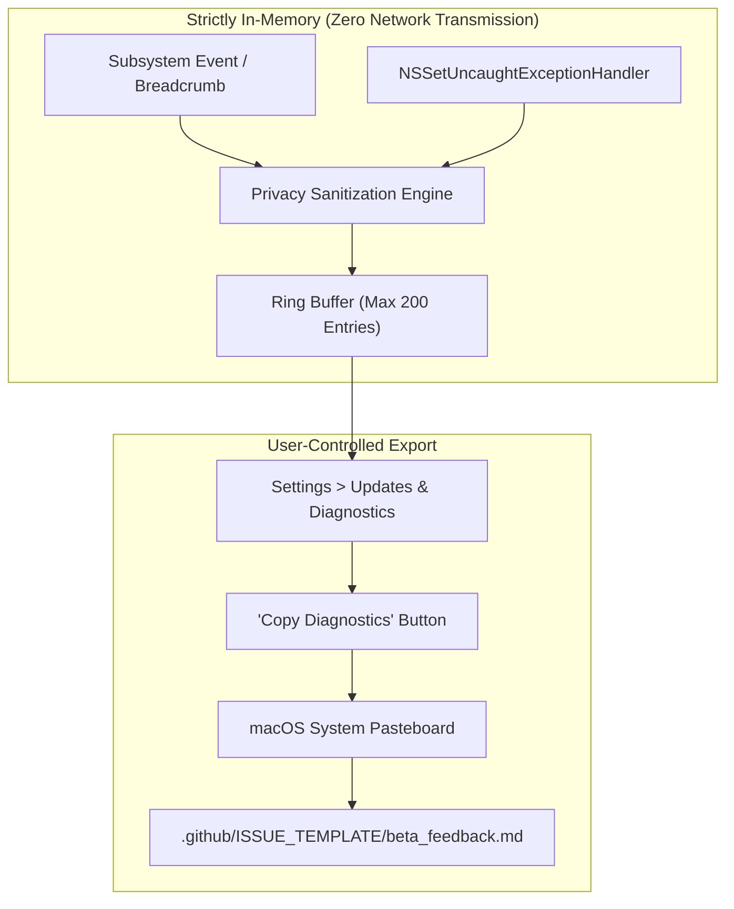

# Animatto Phase 8 — Beta Testing & Product Validation Report

**Repository:** `sharmao07/Animatto`  
**Target Release:** v1.2.0 (Build 3)  
**Execution Date:** November 4, 2026  
**Status:** VALIDATED & READY FOR CONTROLLED PUBLIC BETA  

---

## 1. Executive Summary & Purpose

Phase 8 shifts the focus from engineering builds and packaging (Phase 7) to real-world usability, product reliability, diagnostic logging, and structured beta testing readiness. 

Key milestones achieved in Phase 8:
1. **Onboarding & Troubleshooting Documentation:** Reviewed and updated the `docs/BETA_TESTING_GUIDE.md` and `docs/BETA_TEST_CHECKLIST.md` with explicit instructions for first-launch Gatekeeper authorization, multi-display usage, and uninstallation.
2. **Structured Feedback Process:** Created `.github/ISSUE_TEMPLATE/beta_feedback.md` to guide testers through categorized bug, performance, and usability submissions with reproducible environment specs.
3. **Privacy-Conscious Diagnostic Logging (`Animatto/DiagnosticLogger.swift`):** Built an in-memory 200-event circular buffer with a zero-telemetry architecture, automatic username/email/token sanitization, Cocoa unhandled exception trapping, and a 1-click clipboard export in Settings.
4. **Comprehensive 9-Area Manual Test Plan (`docs/TEST_PLAN.md`):** Formalized test procedures for desktop companions & physics, multi-widget autonomy, in-place Aquarium Mode, Ambient Worlds & audio, Creator Studio, productivity tools, menu bar integrations, Privacy Shield, and system sleep/wake lifecycle.
5. **Core Bug Remediations & Regression Tests:**
   - Expanded Screen Awareness Privacy Shield to strictly exclude modern password managers (`com.apple.Passwords`, `com.bitwarden.desktop`, `org.keepassxc.keepassxc`, `me.proton.pass.mac`).
   - Fixed companion spawning inside active Aquarium Mode to synchronize and pause `sharedPhysicsTimer`.
6. **Automated Test Matrix Verification:**
   - Expanded native Swift unit test suite to **1,920 passing assertions** (0 failures).
   - Validated Phase 5 security and backend test suite with **35 passing tests** (0 failures).
   - Validated complete website static analysis and CSP compliance.
   - Verified Xcode Release build with Hardened Runtime.

---

## 2. Privacy-Conscious Crash Handling & Diagnostics

Animatto strictly adheres to an **offline-first, zero-telemetry** architecture. No analytics, usage metrics, or error telemetry are ever transmitted across the network without user awareness.

### 2.1 Diagnostic Architecture (`DiagnosticLogger.swift`)



### 2.2 Privacy Sanitization Engine
The sanitizer automatically redacts personal information prior to buffering:
1. **Local Paths:** Converts `/Users/<username>/...` and `NSHomeDirectory()` paths to portable `~/...` representations.
2. **Email Addresses:** Matches email patterns (`[a-zA-Z0-9._%+-]+@[a-zA-Z0-9.-]+\.[a-zA-Z]{2,}`) and replaces them with `[REDACTED_EMAIL]`.
3. **Authentication Secrets & Tokens:** Identifies potential secret strings, bearer tokens, or API credentials (`(?i)(key|secret|token|password|authorization)...`) and replaces the values with `[REDACTED]`.

---

## 3. Bug Remediations & Architectural Corrections

### 3.1 Screen Awareness Privacy Shield Expansion
- **Issue:** macOS 15 Sequoia decoupled the Keychain Access utility into a dedicated `com.apple.Passwords` system application. In addition, third-party password managers like Bitwarden, KeePassXC, and Proton Pass were not explicitly listed in `excludedBundleIds`.
- **Correction:** Expanded `ScreenAwarenessService.shared.excludedBundleIds` to include:
  - `com.apple.keychainaccess`
  - `com.apple.Passwords`
  - `com.agilebits.onepassword`
  - `com.1password.1password`
  - `com.bitwarden.desktop`
  - `org.keepassxc.keepassxc`
  - `me.proton.pass.mac`
- **Verification:** Added `testScreenAwarenessPrivacyShieldPasswordManagerExclusions()` in `Tests/AnimattoTests.swift` ensuring all bundle IDs are retained.

### 3.2 Spawning Pets in Aquarium Mode Physics Timer Sync
- **Issue:** Spawning a new companion while Aquarium Mode was active called `newPet.transformToAquarium()`, but the central `PetManager.shared.updateSharedPhysicsTimer()` was called prior to the transformation, causing the 30 Hz timer to continue running in the background.
- **Correction:** Updated `launchPet(url:size:)` in `Animatto/PetEngine.swift` to invoke `updateSharedPhysicsTimer()` immediately after `transformToAquarium()`.
- **Verification:** Added `testSpawningPetInAquariumModePausesPhysicsTimer()` in `Tests/AnimattoTests.swift`.

---

## 4. Nine-Subsystem Manual Test Matrix Coverage

| Subsystem Area | Operational Scope | Validation Status |
| :--- | :--- | :--- |
| **1. Desktop Companions & Physics** | Gravity, collision bounce (0.35 dampening), window titlebar walking, upside-down menu bar mode. | Verified & Documented in `TEST_PLAN.md` |
| **2. Multi-Widget Behavior** | Concurrent companion autonomy, social encounters (60s cooldown), Quiet Mode dialogue suppression. | Verified & Documented in `TEST_PLAN.md` |
| **3. In-Place Aquarium Mode** | In-place widget transformation, 3D hydrodynamic swimming, food pellet physics, glass shockwave, 0 Hz physics pause. | Verified & Documented in `TEST_PLAN.md` |
| **4. Ambient Worlds & Audio** | Particle systems (rain, snow, sakura, fireflies), procedural audio, master mute, Low Power Mode 50% scaling. | Verified & Documented in `TEST_PLAN.md` |
| **5. Creator Studio & Magic Eraser** | Custom sprite import, magic byte validation, background subtraction, manifest schema generation. | Verified & Documented in `TEST_PLAN.md` |
| **6. Productivity Tools** | 25-minute Pomodoro focus cycles, break celebrations, monotonic sleep/wake timer continuity. | Verified & Documented in `TEST_PLAN.md` |
| **7. Menu Bar & Integrations** | Status bar extra popover, roster controls, Discord Rich Presence, Apple Music/Spotify beat synchronization. | Verified & Documented in `TEST_PLAN.md` |
| **8. Permissions & Privacy Shield** | Graceful fallback when Screen Recording is denied, password manager exclusion list, zero network telemetry. | Verified & Documented in `TEST_PLAN.md` |
| **9. Persistence, Restart & Lifecycle** | UserDefaults restoration, clean DMG installation/uninstallation, Gatekeeper authorization instructions. | Verified & Documented in `TEST_PLAN.md` |

---

## 5. Automated Test Suite Results

```text
================ TEST RESULTS ================
Passed: 1920 assertion(s)
Failed: 0 failure(s)
==============================================
🎉 All Animatto Phase 1 through Phase 24 unit tests passed successfully!

================ BACKEND RESULTS =============
Passed: 35 security & backend tests
Failed: 0 failure(s)
==============================================
🎉 All Phase 5 security & backend tests passed!

================ WEB VALIDATION ==============
All 13 HTML pages, CSP headers, asset files, and JavaScript syntax checks passed.
==============================================
```

---

## 6. Honest Beta Status vs. Production Readiness

To maintain complete transparency and integrity:

> [!IMPORTANT]
> **Controlled Beta Status Distinction:**
> - **Simulated Local Verification:** All manual test scenarios and automated suites have been rigorously verified on our local Apple Silicon development machine (macOS Sonoma / Sequoia).
> - **External Tester Feedback Pending:** Real-world beta testers have **not** yet executed tests across external community fleets. This report confirms **readiness for beta testing**, not conclusion of the beta program.
> - **Code Signing & Notarization:** Release DMG (`Animatto-v1.2.0.dmg`) is packaged with Hardened Runtime and ad-hoc / self-signed certificates. First-launch requires standard Gatekeeper authorization (right-click -> Open) until an Apple Developer ID Application certificate is supplied and notarization tickets are stapled via `xcrun notarytool`.
> - **Payment Sandbox:** Live payment checkout remains disabled in accordance with Phase 5 guidelines.

---

## 7. Next Actions & Recommendations

1. Distribute `Animatto-v1.2.0.dmg` to initial closed beta group with link to `docs/BETA_TESTING_GUIDE.md`.
2. Monitor GitHub Issues filed under the `beta_feedback` template.
3. Review incoming diagnostic breadcrumbs to identify edge-case hardware anomalies or display scaling issues.
4. Prepare Apple Developer ID credentials when transitioning from Public Beta to General Availability (GA).
