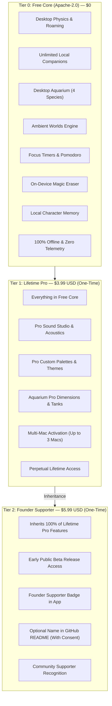

# Animatto — Pricing & Premium Entitlements

**Policy:** [`MONETIZATION_DECISION.md`](MONETIZATION_DECISION.md) is the current decision. The published app stays free under Apache-2.0. The prices below are not a current offer. Checkout is not live, and `ENABLE_PRODUCTION_PAYMENTS` stays unset. Client-side entitlement checks in this repository are not a license to sell the Apache-2.0 code.

**Document Version:** 1.0.0  
**Repository:** `sharmao07/Animatto`  
**Effective Date:** November 4, 2026  
**License Core:** Apache License, Version 2.0  

---

## 1. Executive Summary & Open-Core Philosophy

Animatto is built on an **open-core model** designed to preserve the trust, privacy, and continuous usability of its community:

1. **Permanently Free Core:** All fundamental companion experiences—autonomous roaming, physics, window collision, Aquarium Mode, Ambient Worlds, local character memory, Pomodoro focus timers, procedural audio, and the on-device AI Magic Eraser—are 100% free forever under the Apache-2.0 open-source license.
2. **Zero Hostile Paywalls:** Core capabilities will never be locked behind a paywall, degraded, or crippled to force an upgrade.
3. **No Recurring Subscriptions:** Animatto rejects recurring monthly or annual subscription fees for desktop companion software. All paid tiers are **one-time payments** that grant perpetual lifetime access.
4. **Offline First & Cryptographic Security:** Paid entitlements are verified locally using Ed25519 digital signatures. No constant internet connection, phone-home telemetry, or DRM daemon is required.
5. **Strict Test Mode Isolation:** Live payment checkout remains disabled during beta. All payment infrastructure operates in test sandbox mode.

---

## 2. Two-Tier Pricing Architecture

Animatto replaces legacy one-size-fits-all pricing with a clean, transparent, two-tier model:



### Detailed Tier Comparison

| Feature / Benefit | Free Core | Lifetime Pro | Founder Supporter |
| :--- | :---: | :---: | :---: |
| **Retail Price** | **$0** (Free Forever) | **$3.99 USD** (One-Time) | **$5.99 USD** (One-Time) |
| **Billing Frequency** | None | Single Payment (Lifetime) | Single Payment (Lifetime) |
| **License Terms** | Apache-2.0 Open Source | Perpetual Commercial Grant | Perpetual Commercial Grant |
| **Personal Mac Activations** | Unlimited (Single Mac direct) | Up to 3 Personal Macs | Up to 3 Personal Macs |
| **Desktop Physics, Roaming & Gravity** | ✅ Included | ✅ Included | ✅ Included |
| **Desktop Aquarium (In-Place Transformation)** | ✅ Included | ✅ Included | ✅ Included |
| **Ambient Worlds (Rain, Snow, Sakura)** | ✅ Included | ✅ Included | ✅ Included |
| **On-Device Magic Eraser (Apple Vision)** | ✅ Included | ✅ Included | ✅ Included |
| **Pomodoro Focus Timers & Behavior Sync** | ✅ Included | ✅ Included | ✅ Included |
| **Local Memory & Social Encounters** | ✅ Included | ✅ Included | ✅ Included |
| **Offline Privacy & Zero Telemetry** | ✅ 100% Offline | ✅ 100% Offline | ✅ 100% Offline |
| **Pro Sound Studio & Acoustics** | — | ✅ Included | ✅ Included |
| **Exclusive Custom Palettes & Themes** | — | ✅ Included | ✅ Included |
| **Aquarium Pro Customization** | — | ✅ Included | ✅ Included |
| **Early Public Beta Release Candidate Access** | Standard Releases | Standard Releases | ✅ Early Beta Access |
| **Founder Supporter In-App Recognition** | — | — | ✅ Founder Badge |
| **Repository README Acknowledgement** | — | — | ✅ Optional (With Consent) |

---

## 3. Audited Feature Inventory: Free vs. Pro

To ensure compliance with project guidelines, features are classified strictly based on existing implementations and code-level audits. No artificial or imaginary features are gated.

### 3.1 Implemented & Permanently Free Core Features (`Animatto/`)
- `core_desktop_physics`: Native AppKit transparent window overlays, gravity calculation, velocity damping, window boundary scanning, and upside-down menu bar walking.
- `unlimited_characters`: Spawning and managing multiple desktop companions concurrently without artificial roster quotas.
- `personality_matrix`: 10-trait personality profiles with autonomous need decay and weighted behavioral scoring.
- `contextual_dialogue`: Context-aware speech bubbles triggered by application switches, idle durations, and music playback.
- `character_memory`: Local key-value memory store recording interactions and social history with zero cloud transmission.
- `social_encounters`: Coordinated greetings and mutual interactions when companions cross paths.
- `productivity_sessions`: Pomodoro sprint cycles, break timers, and sleep/wake resilient timing.
- `workshop_studio`: Local sprite imports, animation manifests, and on-device CoreImage/Vision background subtraction.
- `aquarium_widget`: 4 default aquatic species, hydrodynamic 3D physics, touch glass shockwaves, and feeding simulation.
- `ambient_worlds`: Particle rendering overlays (rain, snow, sakura, fireflies) with Low Power Mode scaling.

### 3.2 Candidate & Pro Features
- `pro_sound_studio`: Parametric audio filters, binaural acoustic profiles, and custom ambient loop mixing.
- `pro_custom_palettes`: Extended color gradients, UI accent morphs, and custom companion skin color grading.
- `aquarium_pro`: Custom aquarium aspect ratios, specialized decorative gravel, and extended species schooling behavior.
- `multi_device_3`: Cryptographically verified license token permitting activation across up to 3 personal Macs.
- `founder_badge`: Visual in-app recognition in Settings and the About modal celebrating early project backers.
- `readme_acknowledgement`: Supporter name listed in the project's official GitHub repository README.
- `early_beta_access`: Access to public release candidate builds prior to general availability.

> [!IMPORTANT]
> **Beta Access Clarification:**
> Early beta access grants early availability of public release candidates and beta packages. It does **not** imply or guarantee access to unstable, broken, or unreleased internal development builds.

---

## 4. Entitlement Inheritance & Cryptographic Validation

### 4.1 Entitlement Inheritance Rule
The Founder Supporter tier **strictly inherits 100% of Lifetime Pro benefits**:
$$\text{Entitlements}(\text{Founder}) = \text{Entitlements}(\text{Pro}) \cup \{\text{founder\_badge}, \text{readme\_acknowledgement}, \text{early\_beta\_access}\}$$

In Swift (`Animatto/EntitlementManager.swift`), this is enforced via structural pattern matching:
```swift
if let payload = activePayload {
    if payload.licenseTier == .founder {
        return true // Grants all Pro and Founder features
    }
    if entitlement == .founderBadge || entitlement == .readmeAcknowledgement || entitlement == .earlyBetaAccess {
        return false // Founder-exclusive perks denied to Pro tier
    }
    return true // All Pro features granted to Pro tier
}
```

### 4.2 Ed25519 Token Structure
License tokens follow the standard format:
$$\text{ANIM-PRO-}[\text{Base64URL}(\text{Payload})].[\text{Base64URL}(\text{Ed25519 Signature})]$$

The payload contains:
```json
{
  "orderId": "pay_prod_001",
  "customerEmail": "supporter@example.com",
  "productId": "pdt_animatto_founder_lifetime",
  "tier": "founder",
  "maxDevices": 3,
  "issuedAt": 1762248000,
  "expiresAt": null,
  "entitlements": [
    "pro_sound_studio",
    "pro_custom_palettes",
    "aquarium_pro",
    "multi_device_3",
    "founder_badge",
    "readme_acknowledgement",
    "early_beta_access"
  ],
  "supporterName": "Alex Rivera",
  "supporterConsent": true
}
```

---

## 5. Supporter Name Acknowledgement Process

To protect supporter privacy and comply with privacy regulations (GDPR/CCPA):

1. **Strict Opt-In Consent:**
   - Supporter names are **never** published automatically or by default.
   - At checkout or in license settings, supporters are presented with an unselected checkbox:
     > `[ ] Acknowledge my name in the official GitHub repository README`
   - If unchecked, `supporterConsent` is recorded as `false` and the license is issued anonymously.
2. **Input Sanitization:**
   - Display names are bounded to a maximum of 40 characters.
   - HTML tags, markdown injection sequences, URLs, and prohibited control characters are stripped.
3. **Right to Revoke & Update:**
   - Supporters may request display name changes or complete removal from the README at any time by emailing `support@animatto.app` or opening a GitHub issue.
   - Requesting removal from the README **never** revokes or degrades the supporter's lifetime software license.

---

## 6. Migration Compatibility & Legacy Support

Animatto maintains seamless backward compatibility with all previously issued licenses:

| Existing License / Token Type | Interpreted Tier | Granted Entitlements | Expiration |
| :--- | :--- | :--- | :--- |
| **Legacy `pdt_animatto_premium_lifetime` ($9.99)** | Lifetime Pro | All Pro Entitlements | Perpetual (Lifetime) |
| **Legacy `animatto_pro_lifetime`** | Lifetime Pro | All Pro Entitlements | Perpetual (Lifetime) |
| **New `pdt_animatto_pro_lifetime` ($3.99)** | Lifetime Pro | All Pro Entitlements | Perpetual (Lifetime) |
| **New `pdt_animatto_founder_lifetime` ($5.99)** | Founder Supporter | All Pro + Founder Perks | Perpetual (Lifetime) |

No existing customer requires license reissuance or migration intervention.
