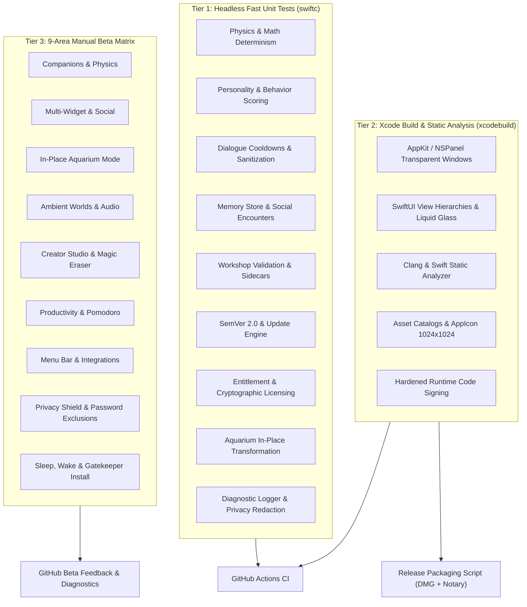

# Animatto — Comprehensive Test Plan & Verification Strategy

**Project:** Animatto (macOS Native Desktop Companion)  
**Target Architecture:** Apple Silicon (arm64) & Intel (x86_64)  
**Primary Frameworks:** Swift 5.9+, SwiftUI, AppKit, Apple Vision, ScreenCaptureKit  
**Document Version:** 1.2.0 (Phase 8 Beta Testing & Validation Baseline)

---

## 1. Test Architecture & Execution Modes

Animatto maintains a multi-tiered validation architecture ensuring high reliability across local development, continuous integration (CI), manual beta testing, and release packaging:



### Execution Commands

1. **Headless Unit Test Suite (1,920 assertions, < 3s execution):**
   ```bash
   swiftc -DDEBUG -sdk $(xcrun --show-sdk-path) $(ls Animatto/*.swift | grep -v AnimattoApp.swift) Tests/AnimattoTests.swift -o /tmp/animatto_tests && /tmp/animatto_tests
   ```

2. **Full Native macOS Xcode Build:**
   ```bash
   xcodebuild -project Animatto.xcodeproj -scheme Animatto -configuration Release -destination 'platform=macOS' CODE_SIGNING_ALLOWED=NO build
   ```

3. **Web Backend & Signature Verification Tests:**
   ```bash
   node web/test/test_backend.js
   npm --prefix web test
   ```

---

## 2. Nine-Subsystem Manual Test Procedures (Beta Matrix)

### Area 1: Desktop Companions & Physics
- **Procedure 1.1 (Gravity & Terminal Velocity):** Click and drag a companion to the top of the display and release. Verify that the companion accelerates downward up to terminal velocity (18 pt/tick), decelerates on ground contact, and bounces with dampening factor 0.35 before settling.
- **Procedure 1.2 (Window Platform Walking):** Position a native macOS window (e.g. Finder or Safari) beneath the companion. Verify the companion detects the top titlebar boundary and walks across it without falling through.
- **Procedure 1.3 (Upside-Down Menu Bar Physics):** Enable Upside-Down Mode in Settings. Verify gravity inverts smoothly, drawing the companion upward to walk along the bottom edge of the macOS menu bar.

### Area 2: Multi-Widget Behavior & Social Dynamics
- **Procedure 2.1 (Concurrent Companion Autonomy):** Spawn 3 or more distinct companions (e.g., Cat, Dog, Rabbit). Verify each operates on independent timers and behavior cycles without stuttering or state bleed.
- **Procedure 2.2 (Social Encounters):** Allow two companions to cross paths. Verify that proximity detection triggers a social greeting, records an interaction in `CharacterMemoryStore`, and observes the 60-second pair cooldown.
- **Procedure 2.3 (Quiet Mode Override):** Toggle Quiet Mode in Settings. Verify that speech bubbles and sound effects are muted while autonomous movement and animations continue normally.

### Area 3: In-Place Aquarium Mode Transformation
- **Procedure 3.1 (In-Place Transformation):** With active desktop companion widgets on screen, toggle Aquarium Mode on. Verify that every desktop widget transitions into an aquatic enclosure in place without creating a separate floating aquarium window.
- **Procedure 3.2 (3D Aquatic Hydrodynamics):** Observe aquatic companions. Verify smooth 3D banking, neutral/negative buoyancy, soft boundary repulsion, and natural swimming arcs.
- **Procedure 3.3 (Interactive Feeding & Glass Tap):** Click inside a transformed aquatic widget to drop dissolvable food pellets; double-tap to create a shockwave dart reaction.
- **Procedure 3.4 (Battery Optimization):** Check that `sharedPhysicsTimer` pauses (0 Hz) while companions are transformed, eliminating unnecessary companion tick overhead.
- **Procedure 3.5 (Restoration):** Toggle Aquarium Mode off. Verify each widget seamlessly reverts back to its ground-based companion form at the exact widget screen position.

### Area 4: Ambient Worlds & Audio Engine
- **Procedure 4.1 (Weather Particulates):** Enable Rain, Snow, Sakura, and Fireflies. Verify smooth 60 FPS particle rendering and click-through transparency (`ignoresMouseEvents = true`).
- **Procedure 4.2 (Audio Lifecycle & Ducking):** Verify ambient sound effects loop smoothly and footstep SFX duck gracefully when multiple companions move simultaneously.
- **Procedure 4.3 (Master Mute):** Click the mute button in the menu bar popover. Confirm all procedural audio stops immediately.
- **Procedure 4.4 (Low Power Mode):** Turn on macOS Low Power Mode in System Settings. Verify particle emission rate automatically scales down by 50% to conserve battery.

### Area 5: Creator Studio & Magic Eraser
- **Procedure 5.1 (Sprite Sheet Import):** Import GIF, PNG sequence, and WebP files. Verify magic bytes validation blocks corrupted or malicious payloads.
- **Procedure 5.2 (Magic Eraser Background Removal):** Use the Magic Eraser color dropper to remove solid backgrounds. Confirm real-time alpha threshold adjustments produce clean anti-aliased sprite borders.
- **Procedure 5.3 (Manifest Schema Integrity):** Verify imported custom companions generate conforming `manifest.json` schemas with appropriate frame rates and state keys.

### Area 6: Productivity & Pomodoro Tools
- **Procedure 6.1 (Pomodoro Focus Cycle):** Start a 25-minute Pomodoro session. Verify companion enters focus animation, speech bubbles are suppressed, and countdown timer progresses accurately.
- **Procedure 6.2 (Break Transition):** At cycle completion, confirm gentle chime audio plays and companion displays an encouraging celebration emote.
- **Procedure 6.3 (Sleep/Wake Synchronization):** Close MacBook lid for 2 minutes and reopen. Verify the timer adjusts monotonically without desync, crash, or clock jump.

### Area 7: Menu Bar & System Integrations
- **Procedure 7.1 (Status Extra Popover):** Click the menu bar icon. Verify quick toggles (Aquarium Mode, Ambient Engine, Master Mute, Roster) respond instantly.
- **Procedure 7.2 (Discord Rich Presence):** Enable Discord integration in Settings. Verify Discord displays Animatto status and active companion name.
- **Procedure 7.3 (Music Rhythm Sync):** Play a song in Apple Music or Spotify with Music Sync enabled. Verify companion bobs rhythmically to the tempo.

### Area 8: Permissions & Privacy Shield
- **Procedure 8.1 (Screen Recording Denied):** Deny Screen Recording permission in macOS System Settings. Confirm Animatto launches and functions with 100% of offline features, companions, and physics working without error prompts.
- **Procedure 8.2 (Privacy Shield Exclusions):** Open Apple Passwords, 1Password, Bitwarden, KeePassXC, or Keychain Access. Verify Screen Awareness strictly suppresses still-image capture (`excludedBundleIds`).
- **Procedure 8.3 (Zero Telemetry Verification):** Monitor local network traffic with a proxy or packet trace. Confirm zero background outbound network requests are made during standard operation.

### Area 9: Persistence, Restart, Sleep & Wake
- **Procedure 9.1 (Clean DMG Installation):** Mount `Animatto-v1.2.0.dmg`, drag `Animatto.app` to `/Applications`, and launch. Verify Gatekeeper first-launch authorization instructions guide the user cleanly.
- **Procedure 9.2 (State Persistence):** Customize companion positions, scales, and audio volume. Quit with `⌘Q` and relaunch. Verify all preferences restore identically.
- **Procedure 9.3 (Clean Uninstallation):** Delete `Animatto.app` and purge `~/Library/Application Support/AnimattoPets` and `~/Library/Preferences/com.sharmao07.Animatto.plist`. Verify no orphaned background daemons or launch agents remain.

---

## 3. Diagnostic Breadcrumbs & Privacy-Conscious Feedback

Animatto v1.2.0 includes an in-memory `DiagnosticLogger` with a strict privacy guarantee:
1. **Local Only:** Diagnostics are stored in a 200-event circular buffer in local memory and are never transmitted over the internet.
2. **Automatic Sanitization:** User home directories (`/Users/<username>` -> `~`), email addresses, and secret bearer tokens are redacted automatically before storage and export.
3. **Tester Control:** Users explicitly copy diagnostics to the macOS clipboard via **Settings (`⌘,`) > Software Updates & Diagnostics > Copy Diagnostics** and paste them into `.github/ISSUE_TEMPLATE/beta_feedback.md`.
