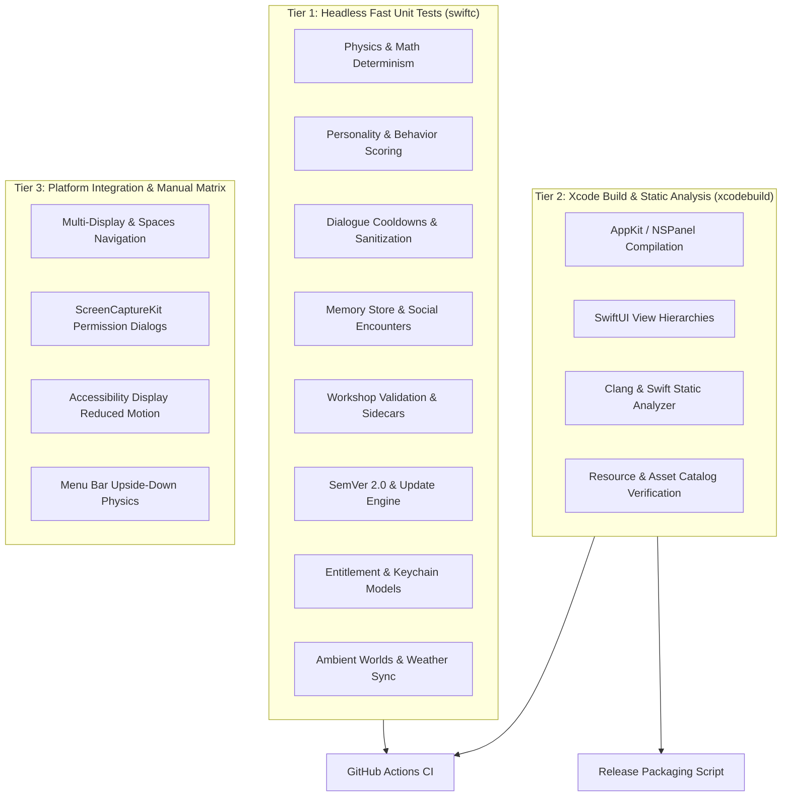

# Animatto — Comprehensive Test Plan & Verification Strategy

**Project:** Animatto (macOS Native Desktop Companion)  
**Target Architecture:** Apple Silicon (arm64) & Intel (x86_64)  
**Primary Frameworks:** Swift 5.9+, SwiftUI, AppKit, Apple Vision, ScreenCaptureKit  
**Document Version:** 1.1.0 (Phase 17 Final Baseline)

---

## 1. Test Architecture & Execution Modes

Animatto maintains a multi-tiered validation architecture ensuring high reliability across local development, continuous integration (CI), and release packaging:



### Execution Commands

1. **Headless Unit Test Suite (884 assertions, < 2.5s execution):**
   ```bash
   swiftc -DDEBUG \
          -sdk $(xcrun --show-sdk-path) \
          -module-cache-path /tmp/swift_cache \
          Animatto/MediaRenderers.swift \
          Animatto/PetStorage.swift \
          Animatto/PersonalityModel.swift \
          Animatto/BehaviorEngine.swift \
          Animatto/PersonalityStorage.swift \
          Animatto/SystemIntegrations.swift \
          Animatto/EnvironmentSystem.swift \
          Animatto/DialogueSystem.swift \
          Animatto/ScreenAwarenessSystem.swift \
          Animatto/CharacterMemoryStore.swift \
          Animatto/SocialInteractionManager.swift \
          Animatto/ProductivityTimerManager.swift \
          Animatto/WorkshopService.swift \
          Animatto/UpdateService.swift \
          Animatto/EntitlementManager.swift \
          Animatto/AmbientModels.swift \
          Animatto/AmbientLocalization.swift \
          Animatto/AmbientEngine.swift \
          Animatto/AmbientMinigameManager.swift \
          Animatto/WeatherSyncService.swift \
          Animatto/AtmospherePackService.swift \
          Tests/AnimattoTests.swift \
          -o /tmp/animatto_unit_tests && /tmp/animatto_unit_tests
   ```

2. **Full Native macOS Build & Static Analysis:**
   ```bash
   xcodebuild -project Animatto.xcodeproj \
              -scheme Animatto \
              -configuration Debug \
              -destination 'platform=macOS' \
              CODE_SIGNING_ALLOWED=NO \
              clean build analyze
   ```

---

## 2. Test Plan Matrix by Subsystem

### 2.1. Physics & Motion Determinism
- **Terminal Velocity:** Falling acceleration is capped at `18.0 pt/tick` to prevent companions tunneling through window frames or screen boundaries.
- **Surface Collision Bounce:** Damping coefficient of `0.35` applied to vertical velocity upon surface contact (`bounceVelocity = -bounceVelocity * 0.35`).
- **Menu Bar Upside-Down Mode:** Inverts gravity from `+0.98 pt/tick²` downwards to `-0.98 pt/tick²` upwards, clamping companion coordinate boundaries to menu bar height (`screen.frame.maxY - 25.0`).
- **Friction Deceleration:** Horizontal movement smoothly decays by factor `0.88` when transitioning from `.walking` to `.idle`.
- **User Drag Override:** Dragging directly pins companion position to mouse coordinates, invalidating autonomous velocities and suppressing autonomous dialogue triggers.

### 2.2. Personality & Behavior Selection
- **Multi-Profile Comparative Divergence:** When exposed to identical event streams:
  - *Curious* companions prioritize `.exploring` (weight +5.0 * curiosity).
  - *Sleepy* companions prioritize `.sleeping` (weight +4.5 * laziness + fatigue factor).
  - *Energetic* companions maintain active `.walking` (energy weight +3.5).
  - *Mischievous* companions trigger playful reactions and cursor chases.
- **Repetition Penalty:** Consecutive identical actions incur exponential penalties (`score -= count * 4.0`), preventing monotonous behavioral loops.
- **Needs Clamping:** Internal drives (`energy`, `happiness`, `boredom`, `curiosityDrive`) are strictly clamped to `[0.0, 1.0]`.

### 2.3. Environmental Awareness & Screen Intelligence
- **Event Debouncing:** Workspace application activation events are debounced with a `0.3s` minimum threshold to prevent notification storms during rapid command-tab switching.
- **Cursor Proximity Hysteresis:** Entry threshold is `130.0 pt` and departure threshold is `180.0 pt` (a `50 pt` deadband preventing jittering state toggles).
- **Zero-Capture Privacy Boundary:** When screen awareness is disabled, `ScreenAwarenessService.shared.observeScreenNow()` immediately aborts with `nil`, ensuring 0 screen frames are captured or buffered in memory.
- **Explicit Cloud Consent Gate:** `CloudVisionProvider` strictly rejects inference requests with `ScreenAwarenessError.cloudConsentRequired` unless explicit opt-in consent is provided.

### 2.4. Dialogue Engine & Speech Bubbles
- **Anti-Spam Cooldown Hierarchy:**
  - Global minimum interval: `3.0s` between any two companions speaking.
  - Character cooldown: `12.0s` minimum between remarks from the same companion.
  - Contextual observation cooldown: `20.0s` minimum.
  - Direct interaction cooldown: `8.0s`.
- **Dialogue Sanitizer:**
  - Strips ANSI escape codes (`\u{001B}[...`) and unprintable control characters.
  - Converts newlines and carriage returns to single spaces.
  - Enforces strict length bounding at `280 characters` to prevent UI denial of service.
- **Stale Context Suppression:** If an event or timer is delayed by `> 5.0s`, dialogue emission is silently dropped.

### 2.5. Character Memory & Multi-Pet Social Interactions
- **Bounded Storage:** Maximum 20 transient memory items (1-hour TTL) and maximum 50 durable items per character.
- **Deduplication:** Multiple social encounters with the same companion consolidate into a single record with incremented interaction count.
- **Social Pair Cooldowns:** Minimum `60.0s` pair cooldown prevents companions from endlessly triggering consecutive social greetings.
- **Social Interruption Safety:** Dragging or flinging either participant instantly terminates active social encounters.

### 2.6. Workshop, Creators & Sidecar Metadata
- **Magic Byte Validation:** File headers are validated (`\x89PNG\r\n\x1a\n`, `GIF87a`/`GIF89a`, `\xFF\xD8\xFF`, `RIFF...WEBP`) rather than trusting file extensions.
- **Path Traversal Protection:** Input filenames are sanitized to prevent `../` or `/` path traversal escapes outside `~/Library/Application Support/AnimattoPets`.
- **Attribution Sidecars:** Preserves `<companion>.meta.json` sidecars capturing author, source URL, and license.

### 2.7. Updater, Entitlements & Privacy Shield
- **Strict SemVer 2.0:** Validates Semantic Versioning precedence (`1.0.0-rc.1 < 1.0.0 < 1.0.1`).
- **Asset Protocol & Domain Restriction:** Rejects non-HTTPS links and restricts download origins to verified GitHub Releases domains.
- **Free Tier Invariance:** All 8 core companion features permanently classified as `.free`.
- **Keychain Storage:** Secure storage for optional license tokens using `kSecClassGenericPassword`.
- **Emergency Privacy Shield:** Instantly halts physics loops, dismisses speech bubbles, mutes audio, and disables background monitoring.

### 2.8. Ambient Worlds, Weather Synchronization & Minigame
- **Decoupled Particle System:** Simulates up to 6 distinct weather types (`rain`, `snow`, `fog`, `sunlight`, `wind`, `leaves`) on an independent click-through `NSPanel` overlay (`ignoresMouseEvents = true`, `.floating` level).
- **Quality Bounds:** Clamps particle count to Low (40), Medium (110), High (260) to protect CPU and battery life.
- **Accessibility Reduced Motion:** Damps velocity vectors and eliminates turbulence when `prefers-reduced-motion` is active.
- **Minigame Spawning & Scoring:** Spawns maximum 6 simultaneous floating collectibles across 4 rarity tiers (`common` 10, `uncommon` 25, `rare` 50, `legendary` 100) with duplicate-click protection and local high score persistence.
- **Open-Meteo Weather Integration:** Maps external conditions to atmospheric effects, supports creative inverse weather mode, enforces 15-minute rate-limiting with offline cache fallback, and enables complete location wiping.
- **Community Atmosphere Pack Validation:** Validates `.animattopack` schemas, enforces a strict 10MB ceiling, and rejects any payload containing executable or script keys.
- **11-Language Localization:** Validates localized string lookup across all 11 supported locales with graceful fallback.

---

## 3. Hardware Requirements & Manual Verification Matrix

The following scenarios require physical macOS desktop environments and cannot be fully validated in headless continuous integration:

| Test Scenario | Prerequisite / Hardware | Expected Result | Status |
| :--- | :--- | :--- | :--- |
| **Multi-Display Coordinate Mapping** | 2+ physical monitors with different resolutions and scaling factors (e.g. 4K Retina + 1080p) | Companions seamlessly cross display edges without window clipping or sudden coordinate jumps | Manual Verification |
| **Mission Control & Spaces Transition** | macOS Virtual Desktops (Spaces) | `.screenSaver` level transparent windows remain visible or switch cleanly without ghost artifacts | Manual Verification |
| **Fullscreen Application Collision** | Frontmost app in native fullscreen mode | Window bounds scanner respects fullscreen window edges or falls back to display bounds | Manual Verification |
| **ScreenCaptureKit Native Consent** | Physical Mac with macOS Screen Recording permissions reset | System displays native macOS security dialog; app handles consent denial gracefully | Manual Verification |
| **Reduced Motion Preference** | System Settings > Accessibility > Display > Reduce Motion | Companion hopping heights and ambient particle animations immediately dampen motion | Manual Verification |
