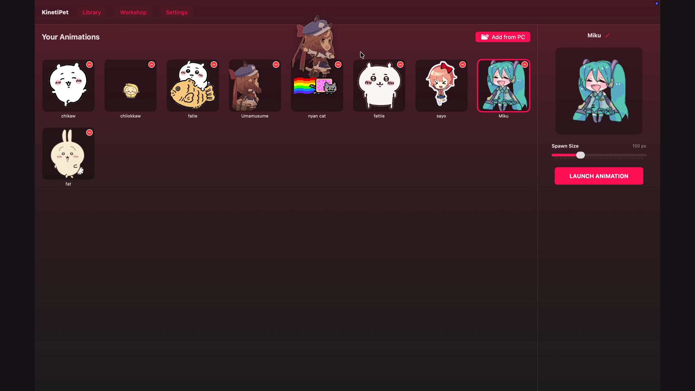

# Animatto Web — Official Showcase & Interactive Playground

The official web showcase and browser playground for **Animatto**, the privacy-focused, native macOS desktop companion application built with Swift, SwiftUI, AppKit, physics simulation, and Phase 17 Ambient Worlds.



---

## 🌟 What is Animatto Web?

Animatto Web is designed to give prospective users and developers an authentic taste of the native macOS application right inside their browser. Instead of presenting generic cards or static mockups, it runs a **high-fidelity interactive desktop playground** powered by a native-inspired 60fps physics loop, particle weather canvas, and simulated AppKit window management.

### Key Capabilities Replicated in the Web Playground

1. **Autonomous Roaming & Surface Collisions:**
   - Companions walk, hop, and rest on top of simulated macOS application windows.
   - Terminal velocity clamping ($18\text{ px/tick}$) matches the native Swift physics engine to prevent window tunneling.
   - Drag-and-drop with natural momentum flinging.

2. **Phase 17 Ambient Worlds & Weather:**
   - Decoupled HTML5 `<canvas>` particle engine supporting **6 atmospheric types**: Rain, Snow, Morning Fog, Golden Sunlight, Brisk Breeze, and Autumn Leaves.
   - Atmospheric presets: *Gentle Rain*, *Autumn Afternoon*, *Winter Wonder*, *Golden Hour*, *Misty Morning*, and *Cozy Cabin*.
   - Dynamic quality tiers: Low (40 particles), Balanced (110 particles), High (260 particles).
   - Reduced motion mode and inverse weather simulation.

3. **Phase 6 Personality Matrix & Needs:**
   - 10 distinct personality archetypes (*Curious Explorer*, *Playful Companion*, *Gentle Guardian*, *Friendly Sidekick*, *Chaotic Jester*, *Sleepy Loaf*, *Stoic Thinker*, *Philosopher*, *Mischievous Sprite*, *Scholarly Reader*).
   - Live personality inspector with four dynamic needs meters: **Energy**, **Happiness**, **Curiosity**, and **Boredom**.

4. **Phase 9 Multi-Character Social Encounters:**
   - Proximity detection triggers coordinated dual-character dialogue when two companions roam near each other (e.g. Chiikawa and Usagi, Miku and Nyan Cat, Umamusume and Fattie).

5. **Phase 10 Focus Sessions (Pomodoro):**
   - 25m Focus / 5m Break timer integrated into both the simulated window and the top macOS menu bar extra.
   - Companions transition into quiet, sleeping states during active focus sessions to maintain user concentration, then celebrate when breaks begin.

6. **Phase 17 Collectibles Minigame:**
   - Weather motes, water drops, and crystals float across the screen.
   - Clicking collectibles triggers visual bursts, score tallying, and celebratory hops from the nearest companion.

7. **Synthesized Apple Web Audio (Zero Audio Dependencies):**
   - Sound effects (pops, hops, chimes, purrs, collectibles) are dynamically synthesized in real-time via the Web Audio API without relying on external `.mp3` or `.wav` files that could fail to load or buffer.

8. **Authentic Native Companion Sprites:**
   - Umamusume (Special Week)
   - Hatsune Miku
   - Chiikawa
   - Sayori
   - Usagi
   - Taiyaki
   - Nyan Cat
   - Fattie

---

## 🛠 Architecture & Zero-Dependency Design

Animatto Web is built using vanilla Web standards:
- **`index.html`**: Semantic HTML5 with Apple HIG styling, bento grid layout, video showcase, comparison tables, and FAQ accordion.
- **`styles.css`**: Pure CSS3 with custom properties, frosted glass acrylic materials (`backdrop-filter: blur(28px)`), smooth spring cubic-bezier transitions, and responsive mobile breakpoints.
- **`app.js`**: Object-oriented ES6+ module orchestrating physics, state machines, particle systems, and event coordination.
- **`vercel.json`**: Production configuration with security headers (`X-Frame-Options: DENY`, `X-Content-Type-Options: nosniff`), clean URLs, and immutable asset caching.

**No compilation, bundling, or `node_modules` required.** The entire application boots instantly with zero cold-start latency.

---

## 🚀 Running Locally

You can serve the directory using any standard static file server:

### Python 3 (Built-in)
```bash
cd web
python3 -m http.server 3000
```
Then open `http://localhost:3000` in your web browser.

### Node.js (npx)
```bash
cd web
npx serve .
```

---

## 📦 Deploying to Vercel

Animatto Web is pre-configured for instant zero-configuration deployment on [Vercel](https://vercel.com):

1. **Option A: Vercel CLI**
   ```bash
   cd web
   vercel
   ```
2. **Option B: GitHub Integration**
   - Import the repository in your Vercel Dashboard.
   - Set **Root Directory** to `web`.
   - Leave Build Command and Output Directory blank.
   - Deploy!

---

## 🧪 Verification & Testing

To run the automated validation test suite:
```bash
node web/test/validate_web.js
```

This validates:
- All required DOM IDs and query selectors are matched.
- All sprite and screenshot assets exist and are accessible.
- No dead links or unhandled errors.

---

## 📄 License

MIT License — see the root [LICENSE](../LICENSE) for details.
